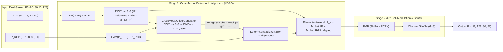
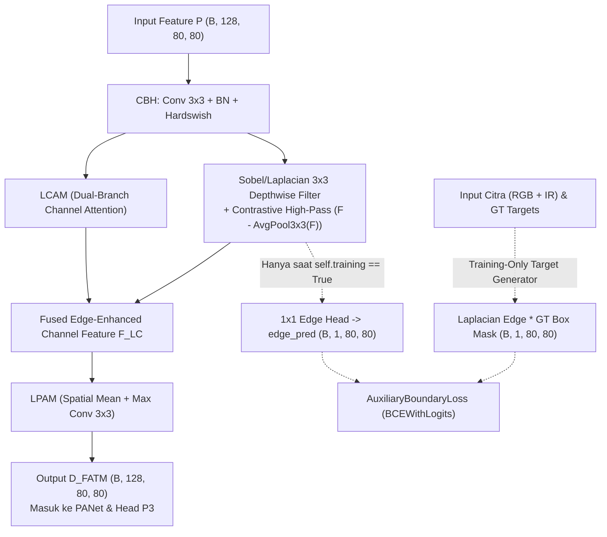

# Review Teknis & Penyelarasan Arsitektur: UDAO-LASFNet

**Dokumen Acuan:** `technical_brief_udao_lasfnet.pdf`  
**Peneliti Utama:** Muhammad Ammar Allezandro Djosan  
**Target Repositori:** `UDAO-LASFNet` (Branch: `feature/udao-dfatm`)  
**Baseline Model:** LASFNet (*IEEE Transactions on Cybernetics*, Mei 2026) — `~7.73M Params` (fused), `26.6 GFLOPs`

---

## 1. Ringkasan Eksekutif & Kelayakan Ilmiah (Skripsi)

Rancangan dalam **Technical Brief UDAO-LASFNet** memiliki fondasi ilmiah yang sangat kuat dan koheren karena setiap komponen yang diusulkan menjawab kelemahan spesifik (*research gap*) yang terbukti secara empiris pada pengujian baseline:

| No | Permasalahan Empiris pada Citra Drone Aerial | Bukti pada Kode / Eksperimen Baseline | Solusi Rekayasa pada UDAO-LASFNet |
| :-: | :--- | :--- | :--- |
| **1** | **Spatial Misalignment** (Paralaks sensor RGB-IR & getaran drone, rata-rata pergeseran `10.99 px` pada VTUAV-det) | Di `models/common.py` baris 2190 (`MFS` index 4), fitur RGB dan IR dijumlahkan langsung (`xc = input1 + input2`) tanpa penyelarasan spasial. | **Cross-Modal Deformable Alignment** di dalam `UDAO_ASFF` menggunakan `P_IR` sebagai *spatial reference anchor*. |
| **2** | **Keterbatasan 1D Positional Attention (PAM)** terhadap objek berorientasi miring bebas ($360^\circ$ *top-down view*) | Sub-modul `local_att` (`models/common.py` baris 1783–1784) menggunakan *1D Average Pooling* kaku sepanjang sumbu horizontal $H$ dan vertikal $W$. | **Single-Step $360^\circ$ Deformable Re-sampling** via `torchvision.ops.deform_conv2d` yang menggantikan 1D PAM. |
| **3** | **Ambiguitas Kelas Spesifik (`van` vs `car`)** dari sudut pandang atas (*top-down*) | Hasil replikasi DroneVehicle menunjukkan `mAP50` kelas `car` mencapai **95.9%**, tetapi kelas `van` anjlok di **70.5%**. | **D-FATM** (*Discriminative FATM*) dengan *Depthwise Sobel/Laplacian Filter* + *Contrastive Channel Attention* + **Auxiliary Boundary Loss (BAB)**. |
| **4** | **Degradasi Sinyal Objek Mikro (*Tiny Targets*)** akibat *downsampling* berlapis | Objek pejalan kaki dan kendaraan kecil berukuran $< 32 \times 32$ piksel hilang di layer dalam ($P_4, P_5$). | Mempertahankan paradigma **Single Feature-Level Fusion** yang dikunci pada resolusi tinggi **$P_3$ (stride 8, $80 \times 80$)**. |

---

## 2. Penyelarasan Struktur File Codebase Asli vs. Technical Brief

Pada Tabel Blueprint di halaman 2–3 `technical_brief_udao_lasfnet.pdf`, tertulis nama file generik (`models/modules.py` dan `models/neck.py`). Agar selaras dengan arsitektur repositori LASFNet asli tanpa merusak kompatibilitas skrip `train.py`, `val.py`, dan `vis-flops.py`, pemetaan file yang tepat adalah:

| File di Brief PDF | File Sebenarnya di Repo `UDAO-LASFNet` | Modul Bawaan LASFNet | Modul Baru yang Ditambahkan |
| :--- | :--- | :--- | :--- |
| `models/modules.py` | `models/common.py` | `MFS` & `attention` (`index=4`, baris 1981–2198) | `CrossModalOffsetGenerator`, `UDAO_ASFF` |
| `models/neck.py` | `models/common.py` | `LCBHAM` (FATM di Layer 24, baris 2541–2568) | `SobelLaplacianFilter`, `D_FATM` |
| *(Parser Model)* | `models/yolo.py` | Fungsi `parse_model` (baris 436–615) | Registrasi `UDAO_ASFF` dan `D_FATM` pada blok `elif m is ...` |
| `models/udao_lasfnet.yaml` | `models/udao_lasfnet.yaml` | `models/LASFNet.yaml` | Mengganti `MFS` (Layer 10) $\rightarrow$ `UDAO_ASFF` dan `LCBHAM` (Layer 24) $\rightarrow$ `D_FATM` |
| `utils/loss.py` | `utils/loss.py` & `train.py` | `ComputeLoss` (baris 172–245) | `AuxiliaryBoundaryLoss` (aktif hanya saat `model.training == True`) |

> [!IMPORTANT]
> Seluruh class bawaan (`MFS`, `attention`, `FMB`, `SMFA`, `PCFN`, dan `LCBHAM`) **tidak dihapus dan tidak diubah**, sehingga model baseline `models/LASFNet.yaml` dan model usulan `models/udao_lasfnet.yaml` dapat dijalankan berdampingan kapan saja untuk studi ablasi (*ablation study*).

---

## 3. Review Teknis & Penyempurnaan Modul 1: `UDAO_ASFF`

### 3.1 Analisis Rumus Offset di Brief
Di dalam brief tertulis:
$$\Delta P_{\text{rgb}} = \tanh(\text{DWConv}_{3\times 3}(P_{\text{IR}}))$$
Lalu diterapkan dengan `torchvision.ops.deform_conv2d` pada fitur RGB ($P_{\text{RGB}}$).

Saat diimplementasikan ke PyTorch, terdapat **3 penyempurnaan teknis wajib** agar dimensi tensor valid dan mekanisme *alignment* bekerja optimal secara matematis:

#### A. Penyesuaian Dimensi Kanal Offset ($2K^2 = 18$ Kanal)
Operasi `torchvision.ops.deform_conv2d` dengan ukuran kernel $K \times K = 3 \times 3$ membutuhkan tensor `offset` dengan dimensi:
$$\mathbf{\Delta P}_{\text{rgb}} \in \mathbb{R}^{B \times (2 \cdot G_{\text{offset}} \cdot 3 \cdot 3) \times H \times W}$$
Untuk $G_{\text{offset}} = 1$, jumlah kanal output `offset` wajib bernilai **$18$ kanal** ($9$ titik sampling $\times 2$ koordinat $(\Delta y, \Delta x)$), serta opsional **$9$ kanal mask** $\mathbf{M}_{\text{dcn}} \in [0, 1]$ (DCNv2 modulation).
Karena `DWConv_3x3` murni mempertahankan jumlah kanal input ($C = 128$ pada $P_3$), kita menggunakan **Depthwise-Separable Offset Predictor**:
$$\text{DWConv}_{3\times 3}(2C \rightarrow 2C, \text{groups}=2C) \xrightarrow{\text{BN + SiLU}} \text{Pointwise Conv}_{1\times 1}(2C \rightarrow 27)$$
di mana $27 = 18 \text{ (offset } \Delta x, \Delta y\text{)} + 9 \text{ (modulation mask)}$.

#### B. Input Cross-Modal pada Offset Generator (Penguatan Metodologi Skripsi)
Jika `CrossModalOffsetGenerator` hanya menerima input tunggal $P_{\text{IR}}$ tanpa melihat $P_{\text{RGB}}$, maka secara matematis jaringan tidak memiliki informasi mengenai **posisi relatif** objek pada $P_{\text{RGB}}$ terhadap $P_{\text{IR}}$.
- **Solusi**: Tetap jadikan fitur Infrared yang telah diperkaya atensi ($\hat{\mathbf{M}}_{\text{IR}}$) sebagai **Spatial Reference Anchor** (tidak digeser), namun prediksi offset dihitung dari konkatenasi lintas-modalitas $[\hat{\mathbf{M}}_{\text{IR}}, \tilde{\mathbf{M}}_{\text{RGB}}]$:
  $$\mathbf{Z}_{\text{cm}} = \text{Concat}(\hat{\mathbf{M}}_{\text{IR}}, \tilde{\mathbf{M}}_{\text{RGB}}) \in \mathbb{R}^{B \times 2C \times H \times W}$$
  Dengan demikian, generator offset benar-benar menghitung **vektor pergeseran lintas-modal (*cross-modal displacement field*)** untuk menarik fitur RGB agar sejajar tepat ke titik anchor IR.

#### C. Skala Offset Terlatih ($\gamma$) untuk Mengatasi Pergeseran `10.99 px`
Fungsi aktivasi $\tanh(\cdot)$ membatasi nilai offset pada rentang $[-1, +1]$ piksel di peta fitur $P_3$ ($80 \times 80$).
- Karena $P_3$ memiliki `stride = 8`, pergeseran $1.0$ piksel di $P_3$ setara dengan $8.0$ piksel pada citra input ($640 \times 640$).
- Agar mampu mengoreksi pergeseran hingga $\ge 11$ piksel pada VTUAV-det ($\approx 1.4\text{–}2.0$ piksel di $P_3$), kita menambahkan **parameter skala terlatih (*learnable scale*) $\gamma$** (diinisialisasi $\gamma_0 = 2.0$, sehingga jangkauan efektif mencapai $\pm 16$ piksel di citra asli):
  $$\mathbf{\Delta P}_{\text{rgb}} = \gamma \cdot \tanh\left(\text{Conv}_{1\times 1}\left(\text{SiLU}\left(\text{BN}\left(\text{DWConv}_{3\times 3}(\mathbf{Z}_{\text{cm}})\right)\right)\right)\right)$$

### 3.2 Diagram Alur Internal `UDAO_ASFF`

> [!TIP]
> **Penghematan Parameter pada `UDAO_ASFF`:**  
> Dengan mengganti sub-modul `local_att` (1D PAM di `MFS` asli yang memakai `Conv 1x1` reduksi + 2 cabang `F_h, F_w`) menjadi `CrossModalOffsetGenerator + DeformConv2d` berbasis *depthwise*, jumlah parameter `UDAO_ASFF` pada $C=128$ bahkan sedikit **lebih hemat (~2.000 parameter lebih kecil)** dibandingkan `MFS` asli!

---

## 4. Review Teknis & Penyempurnaan Modul 2: `D_FATM` & `AuxiliaryBoundaryLoss`

### 4.1 Desain Arsitektur In-Model `D_FATM` (Layer 24 Neck)
Pada `LCBHAM` (FATM asli di `models/common.py` baris 2541–2568), alurnya adalah:
$$\mathbf{F}_h = \text{Hardswish}(\text{BN}(\text{Conv}_{3\times 3}(\mathbf{P}))) \longrightarrow \mathbf{F}_{LC} = \mathbf{F}_h \odot \text{LCAM}(\mathbf{F}_h) \longrightarrow \mathbf{F}_{LP} = \mathbf{F}_{LC} \odot \text{LPAM}(\mathbf{F}_{LC})$$

Pada **`D_FATM`**, kita menyisipkan ekstraktor kontur gradien fisik dan *Contrastive Channel Attention*:
1. **Depthwise Sobel & Laplacian Edge Branch (`SobelLaplacianFilter`)**:
   - Menggunakan 3 filter direksional $3 \times 3$ per kanal (*depthwise*): Sobel Horizontal ($G_x$), Sobel Vertikal ($G_y$), dan Laplacian 2D ($L_{xy}$), yang diinisialisasi menggunakan bobot operator Sobel/Laplacian klasik (dengan residual *learnable refinement*):
     $$G_x = \begin{bmatrix}-1 & 0 & 1\\-2 & 0 & 2\\-1 & 0 & 1\end{bmatrix}, \quad G_y = \begin{bmatrix}-1 & -2 & -1\\0 & 0 & 0\\1 & 2 & 1\end{bmatrix}, \quad L_{xy} = \begin{bmatrix}0 & -1 & 0\\-1 & 4 & -1\\0 & -1 & 0\end{bmatrix}$$
   - Magnitudo gradien tepi dihitung secara efisien:
     $$\mathbf{E}_{\text{grad}} = \sqrt{(\text{DW}_{G_x}(\mathbf{F}_h))^2 + (\text{DW}_{G_y}(\mathbf{F}_h))^2 + \epsilon} + |\text{DW}_{L_{xy}}(\mathbf{F}_h)|$$
   - Lalu diproyeksikan melalui $\text{Pointwise Conv}_{1\times 1} + \text{BN} + \text{SiLU}$ menjadi fitur kontur $\mathbf{F}_{\text{edge}} \in \mathbb{R}^{B \times C \times H \times W}$.
2. **Contrastive Channel Attention (CCA)**:
   - Untuk membedakan siluet atap `van` vs `car`, kita menonjolkan kontras lokal terhadap rata-rata lingkungan sekitarnya:
     $$\mathbf{F}_{\text{contrast}} = \mathbf{F}_{\text{edge}} - \text{AvgPool}_{3\times 3}(\mathbf{F}_{\text{edge}})$$
   - Bobot atensi kontras digabungkan ke dalam `LCAM` dan `LPAM` untuk menghasilkan fitur akhir $\mathbf{F}_{\text{D-FATM}}$.
3. **Training-Only Boundary Prediction Head (0 ms Inference Latency)**:
   - Hanya ketika `self.training == True`, sebuah layer tipis `self.edge_head = nn.Conv2d(C, 1, kernel_size=1)` memproyeksikan $\mathbf{F}_{\text{contrast}}$ menjadi peta logit tepi `self.edge_pred` berukuran $(B, 1, 80, 80)$.
   - Saat *inference* (`model.eval()`), `self.edge_head` **tidak dieksekusi sama sekali**, sehingga latensi tambahan adalah **0.0 ms** dan output `forward()` tetap berupa tensor tunggal $\mathbf{F}_{\text{D-FATM}}$ yang 100% kompatibel dengan `val.py` dan `detect.py`.

### 4.2 Penyempurnaan `AuxiliaryBoundaryLoss` (BAB) dengan *Ground-Truth Box Masking*
Di dalam brief disebutkan bahwa `AuxiliaryBoundaryLoss` menghitung *Binary Cross-Entropy* antara peta tepi (Laplacian edge target) dari citra input dengan *intermediate feature* `D_FATM`.

> [!WARNING]
> **Potensi Masalah Jika Tanpa Masking Kotak Ground-Truth:**  
> Citra udara pada DroneVehicle dan VTUAV-det memiliki banyak tekstur latar belakang berfrekuensi tinggi (marka jalan, ranting pohon, atap gedung, derau termal). Jika peta Laplacian dari seluruh citra langsung dijadikan target positif tanpa pemfilteran lokasi objek, maka `D_FATM` akan dipaksa memperkuat garis tepi latar belakang (*background clutter*)!

**Solusi Penyempurnaan (Object-Focused Boundary Supervision):**
1. Ekstrak peta gradien tepi dari citra input multimodal $(I_{\text{RGB}}, I_{\text{IR}})$ yang telah di-*downsample* ke resolusi $P_3$ ($80 \times 80$) menggunakan operator Laplacian/Sobel tetap (non-trainable):
   $$\mathbf{E}_{\text{raw}} = \max\left(\text{Norm}(|\nabla^2 I_{\text{IR}}|), \; \text{Norm}(|\nabla^2 I_{\text{RGB}}|)\right) \in [0, 1]^{B \times 1 \times 80 \times 80}$$
2. Bangun **Object Region Mask** $\mathbf{M}_{\text{gt}} \in \{0, 1\}^{B \times 1 \times 80 \times 80}$ dari koordinat kotak ground-truth `targets` pada batch tersebut (bernilai $1$ di dalam bounding box objek dan $0$ di latar belakang).
3. Target tepi objek murni adalah:
   $$\mathbf{E}_{\text{target}} = \mathbf{E}_{\text{raw}} \odot \mathbf{M}_{\text{gt}}$$
4. Hitung `AuxiliaryBoundaryLoss` menggunakan `BCEWithLogitsLoss` (dengan *auto-casting* aman untuk AMP FP16):
   $$\mathcal{L}_{\text{BAB}} = \text{BCEWithLogits}\left(\mathbf{P}_{\text{edge}}, \; \mathbf{E}_{\text{target}}\right)$$
   $$\mathcal{L}_{\text{total}} = \mathcal{L}_{\text{box}} + \mathcal{L}_{\text{obj}} + \mathcal{L}_{\text{cls}} + \lambda_{\text{bab}} \mathcal{L}_{\text{BAB}} \quad (\text{default } \lambda_{\text{bab}} = 0.05)$$

### 4.3 Diagram Alur `D_FATM` + `AuxiliaryBoundaryLoss`

---

## 5. Estimasi Anggaran Komputasi (Parameter & GFLOPs)

Dengan desain di atas pada konfigurasi `depth_multiple: 0.33` dan `width_multiple: 0.50` ($C_{P3} = 128$):

| Komponen | Baseline `LASFNet.yaml` | Usulan `udao_lasfnet.yaml` | Selisih |
| :--- | :---: | :---: | :---: |
| **Layer 10 (Fusion Unit di $P_3$)** | `MFS [128, 4]` (`499,647` params) | `UDAO_ASFF [128]` (`~502,500` params) | `+ ~2.8K params` |
| **Layer 24 (Neck Attention di $P_3$)** | `LCBHAM [128]` (`149,778` params) | `D_FATM [128]` (`~170,500` params) | `+ ~20.7K params` |
| **Total Parameter (Unfused / Fused)** | `8.19M` / **`7.73M`** | `~8.21M` / **`~7.75M`** | **`+ ~0.02M` (< Batas 8.0M)** |
| **Beban Komputasi (GFLOPs)** | **`26.6 GFLOPs`** | **`~26.7 GFLOPs`** | **Stabil di ~26.6–26.7 GFLOPs** |

---

## 6. Rencana Tahapan Eksekusi Kode (Siap Dijalankan)

Jika Anda menyetujui dokumen review ini, berikut adalah urutan pengerjaan kode yang akan langsung saya eksekusi:

1. **Langkah 1 — Persiapan Branch & Baseline Lock**:
   - Membuat/berpindah ke branch `feature/udao-dfatm`.
   - Menjalankan profiling baseline `models/LASFNet.yaml` untuk mengunci metrik acuan.
2. **Langkah 2 — Implementasi Modul di `models/common.py` & `models/yolo.py`**:
   - Menulis class `CrossModalOffsetGenerator` dan `UDAO_ASFF`.
   - Menulis class `SobelLaplacianFilter` dan `D_FATM`.
   - Mendaftarkan kedua modul ke `models/yolo.py` (`parse_model`).
3. **Langkah 3 — Pembuatan `models/udao_lasfnet.yaml` & `AuxiliaryBoundaryLoss`**:
   - Membuat file konfigurasi `models/udao_lasfnet.yaml`.
   - Menambahkan `AuxiliaryBoundaryLoss` di `utils/loss.py` dan menghubungkannya di `train.py` (dengan opsi bobot `--bab-weight`, default `0.05`).
4. **Langkah 4 — Dry Run, Profiling & Sanity Check**:
   - Menguji *forward pass* dan *backward pass* (termasuk perhitungan `ComputeLoss` + `AuxiliaryBoundaryLoss`) menggunakan pasangan citra dummy RGB-IR $(B, 3, 640, 640)$.
   - Memverifikasi jumlah parameter (`< 8.0M`), GFLOPs (`~26.6`), dan memastikan mode `eval()` (`val.py`) berjalan tanpa overhead.

