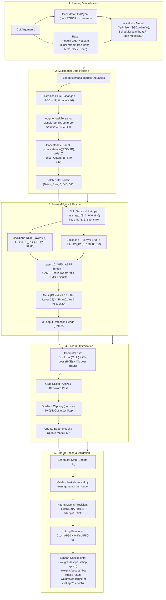

# Dokumentasi Alur Kerja Teknis (Technical Workflow) LASFNet
*End-to-End Pipeline dari Eksekusi Colab hingga Evaluasi Model*

Dokumentasi ini menyajikan alur kerja teknis (*end-to-end technical workflow*) dari repositori **LASFNet** (*Lightweight Attention-Guided Self-Modulation Feature Fusion Network*). Penjelasan ini dirancang untuk kebutuhan analisis teknis, penulisan metodologi skripsi, serta pemahaman komprehensif atas proses yang terjadi saat menjalankan training di Google Colab.

---

## 1. Ringkasan Eksekusi Google Colab

Perintah training yang biasa dijalankan pada sel Google Colab:

```bash
!python train.py \
  --imgsz 640 \
  --batch-size 48 \
  --epochs 300 \
  --data data/LLVIP.yaml \
  --weights '' \
  --cfg models/LASFNet.yaml \
  --device 0 \
  --project "/content/drive/MyDrive/Skripsi/LASFNet_LLVIP_Run" \
  --name full_train_300ep \
  --save-period 20 \
  --exist-ok
```

---

## 2. Diagram Alur Sistem (End-to-End Flowchart)



---

## 3. Tahapan Rinci Workflow

### Tahap 1: Inisialisasi & Pembacaan Konfigurasi (`train.py`)

1. **Argumen CLI:** Script `train.py` menguraikan argumen baris perintah (`--data`, `--cfg`, `--epochs`, `--batch-size`, dll.).
2. **Parsing Dataset YAML (`data/LLVIP.yaml` atau `data/dronevehicle_new.yaml`):**
   * Mengambil path direktori: `train_rgb`, `train_ir`, `val_rgb`, dan `val_ir`.
   * Mengambil jumlah kelas target (`nc: 1` untuk orang pada LLVIP, atau multikelas untuk DroneVehicle) dan nama label (`names`).
3. **Instansiasi Arsitektur Model (`models/yolo.py` & `models/LASFNet.yaml`):**
   * `Model` membaca konfigurasi layer:
     * **Layer 0–4:** Stream backbone pertama untuk modalitas RGB.
     * **Layer 5–9 (`from: -4`):** Stream backbone kedua untuk modalitas IR (mengambil input citra ke-2).
     * **Layer 10 (`MFS`):** Modul fusi multimodal yang menggabungkan fitur dari layer 4 dan layer 9.
     * **Layer 11–31:** Neck ekstraksi fitur (PANet, modul atensi LCBHAM di layer 24) dan modul `Detect`.
4. **Setup Komponen Pembelajaran:**
   * **Optimizer:** Diinisialisasi melalui `smart_optimizer` (default SGD dengan momentum 0.937 dan weight decay yang disesuaikan ukuran batch).
   * **LR Scheduler:** Mengatur penurunan learning rate secara bertahap (cosine annealing atau linear decay).
   * **ModelEMA:** Menjaga salinan bobot rata-rata bergerak eksponensial untuk evaluasi yang lebih stabil.

---

### Tahap 2: Dataloader Multimodal (`utils/dataloaders.py`)

Proses pemuatan data pada LASFNet ditangani khusus oleh `create_dataloader_rgb_ir` dan `LoadMultiModalImagesAndLabels`:

1. **Pairing File Citra & Label:**
   * Sistem membaca daftar file gambar pada folder RGB dan IR, lalu melakukan sorting alfabetis yang ketat agar indeks ke-$i$ pada citra RGB cocok secara spasial dan temporal dengan indeks ke-$i$ pada citra IR.
   * File label bounding box `.txt` (format YOLO: `class x_center y_center width height` ternormalisasi) dibaca dan disimpan dalam bentuk `.cache` untuk mempercepat pemuatan di epoch berikutnya.
2. **Augmentasi Sinkron di `__getitem__`:**
   * Citra RGB dan IR diproses bersamaan agar koordinat bounding box tetap konsisten:
     * **Mosaic Augmentation:** 4 citra RGB dan 4 citra IR disatukan dengan titik potong matriks (*mosaic center*) yang identik.
     * **Letterbox Resizing:** Citra di-resize ke resolusi target `640x640` dengan penambahan padding simetris.
     * **Random Flip & HSV:** Transformasi spasial (flip horizontal/vertikal) diterapkan secara identik ke kedua modalitas.
3. **Penggabungan Kanal (Channel Concatenation):**
   * Format citra awal:
     * RGB: `(3, H, W)`
     * IR: `(3, H, W)`
   * Di baris kode:
     ```python
     img_all = np.concatenate((img_rgb, img_ir), axis=0)  # Output shape: (6, H, W)
     ```
   * Dataloader menghasilkan batch tensor berukuran:
     $$\mathbf{X}_{\text{batch}} \in \mathbb{R}^{B \times 6 \times 640 \times 640}$$

---

### Tahap 3: Eksekusi Iterasi Batch & Forward Pass

Untuk setiap iterasi batch pada suatu epoch:

1. **Pemisahan Kembali Modalitas Citra:**
   * Nilai piksel tensor dikonversi ke tipe data float dan dinormalisasi ke rentang `[0.0, 1.0]`:
     ```python
     imgs = imgs.to(device).float() / 255.0
     imgs_rgb = imgs[:, :3, :, :]  # Shape: (B, 3, 640, 640)
     imgs_ir  = imgs[:, 3:, :, :]  # Shape: (B, 3, 640, 640)
     ```
2. **Forward Pass Jaringan (`models/yolo.py`):**
   * Di dalam fungsi `_forward_once(self, x, x2)`:
     * `x` (RGB) diproses oleh **Layer 0–4** $\rightarrow$ menghasilkan feature map $P_3^{RGB}$ berukuran `(B, 128, 80, 80)`.
     * `x2` (IR) diproses oleh **Layer 5–9** (kondisi `m.f == -4`) $\rightarrow$ menghasilkan feature map $P_3^{IR}$ berukuran `(B, 128, 80, 80)`.
     * **Layer 10 (`MFS`, index 4):**
       Kedua feature map masuk ke modul fusi:
       $$\mathbf{F}_{\text{fused}} = \text{MFS}(P_3^{RGB}, P_3^{IR})$$
       Alur internal modul fusi:
       1. **Channel Attention (CAM):** Menghitung pembobotan kepentingan kanal masing-masing modalitas.
       2. **Penjumlahan Fitur Element-wise:** $\mathbf{x}_c = \mathbf{x}_{rgb} + \mathbf{x}_{ir}$.
       3. **Coordinate Attention (`local_att`):** Menangkap informasi arah spasial $H$ dan $W$.
       4. **Feature Modulation Block (`fmb`) & Channel Shuffle:** Mengacak dan menyatukan representasi fitur antar modalitas.
     * **Neck & Detection Heads:**
       Fitur fusi $\mathbf{F}_{\text{fused}}$ kemudian diekspansi ke level resolusi $P_4$ `(B, 256, 40, 40)` dan $P_5$ `(B, 512, 20, 20)`, melewati modul atensi LCBHAM di layer 24, dan masuk ke 3 head deteksi:
       * **Head P3 (Stride 8):** Grid $80 \times 80$ untuk mendeteksi objek berukuran kecil.
       * **Head P4 (Stride 16):** Grid $40 \times 40$ untuk mendeteksi objek berukuran sedang.
       * **Head P5 (Stride 32):** Grid $20 \times 20$ untuk mendeteksi objek berukuran besar.

3. **Kalkulasi Loss (`ComputeLoss` di `utils/loss.py`):**
   * Prediksi dibandingkan dengan label target (*ground truth*):
     * $\mathcal{L}_{\text{box}}$: **CIoU Loss** (mengukur tumpang tindih area, jarak titik pusat, dan rasio aspek bounding box).
     * $\mathcal{L}_{\text{obj}}$: **Objectness Loss** (BCE With Logits Loss untuk memprediksi probabilitas keberadaan objek pada cell grid).
     * $\mathcal{L}_{\text{cls}}$: **Classification Loss** (BCE With Logits Loss untuk ketepatan prediksi kelas objek).
   * Total loss:
     $$\mathcal{L}_{\text{total}} = \lambda_{\text{box}} \mathcal{L}_{\text{box}} + \lambda_{\text{obj}} \mathcal{L}_{\text{obj}} + \lambda_{\text{cls}} \mathcal{L}_{\text{cls}}$$

4. **Backward Pass & Pembaruan Bobot:**
   * Gradien dihitung melalui `scaler.scale(loss).backward()`.
   * Setelah akumulasi batch terpenuhi:
     * Dilakukan unscaling gradien dan pembatasan norma gradien (`torch.nn.utils.clip_grad_norm_ <= 10.0`).
     * `scaler.step(optimizer)` memperbarui bobot model.
     * `ema.update(model)` memperbarui bobot rata-rata bergerak model.
     * Gradien di-reset ke nol (`optimizer.zero_grad()`).

---

### Tahap 4: Evaluasi Akhir Epoch & Checkpoint Model

Ketika seluruh batch pada epoch tersebut selesai dijalankan:

1. **Pembaruan Learning Rate:**
   * Scheduler melangkah (`scheduler.step()`) menurunkan learning rate sesuai kurva penjadwalan.
2. **Validasi Model (`val.py`):**
   * Model EMA (`ema.ema`) dievaluasi pada dataset pengujian (`val_loader`).
   * Algoritma **NMS (Non-Maximum Suppression)** menyaring bounding box yang berlebih.
   * Metrik deteksi objek dihitung secara komprehensif:
     * **Precision ($P$)** dan **Recall ($R$)**.
     * **mAP@0.5**: Rata-rata precision pada ambang batas IoU 0.5.
     * **mAP@0.5:0.95**: Rata-rata precision lintas ambang batas IoU 0.5 sampai 0.95 dengan interval 0.05.
3. **Kalkulasi Fitness:**
   * Tingkat keberhasilan model dihitung dengan rumus:
     $$\text{Fitness} = 0.1 \times \text{mAP}@0.5 + 0.9 \times \text{mAP}@0.5:0.95$$
4. **Penyimpanan Bobot Checkpoint:**
   * **`weights/last.pt`:** Diperbarui setiap akhir epoch. Menyimpan bobot terkini, optimizer state, epoch saat ini, dan hyperparameter untuk memungkinkan proses pelatihan dilanjutkan (*resume training*).
   * **`weights/best.pt`:** Diperbarui **hanya jika** nilai $\text{Fitness}$ pada epoch tersebut mengalahkan rekor nilai tertinggi sebelumnya.
   * **`weights/epoch{N}.pt`:** Disimpan setiap interval 20 epoch (karena parameter `--save-period 20`).

---

## 4. Tabel Perubahan Bentuk Tensor (Tensor Flow Mapping)

| Tahapan Alur | Modul / Script | Dimensi / Bentuk Tensor | Keterangan |
| :--- | :--- | :--- | :--- |
| **Penyimpanan Lokal** | Disk / Dataset | Format Citra `.jpg`/`.png` | Berpasangan (visible & infrared) |
| **Output Dataloader Sample** | `LoadMultiModalImagesAndLabels` | `(6, 640, 640)` | Concatenate RGB (3) + IR (3) |
| **Batch DataLoader** | `train_loader` | `(B, 6, 640, 640)` | $B = \text{Batch Size}$ (misal: 48) |
| **Input Split** | `train.py` | `imgs_rgb`: `(B, 3, 640, 640)`<br/>`imgs_ir`: `(B, 3, 640, 640)` | Dipisah sebelum forward pass |
| **Backbone P3 (RGB)** | Layer 0–4 (`Conv`, `C3`) | `(B, 128, 80, 80)` | Fitur spasial level $1/8$ dari RGB |
| **Backbone P3 (IR)** | Layer 5–9 (`Conv`, `C3`) | `(B, 128, 80, 80)` | Fitur spasial level $1/8$ dari IR |
| **Multimodal Fusion** | Layer 10 (`MFS`, index 4) | `(B, 128, 80, 80)` | Penyatuan representasi multimodal |
| **Neck Features** | Layer 11–30 (`PANet`, `LCBHAM`) | P3: `(B, 128, 80, 80)`<br/>P4: `(B, 256, 40, 40)`<br/>P5: `(B, 512, 20, 20)` | Fitur multiskala kaya semantik |
| **Output Detection Heads** | Layer 31 (`Detect`) | List 3 Tensor Prediksi Grid | Format: `[B, 3, Ny, Nx, 5 + nc]` |
| **Perhitungan Loss** | `ComputeLoss` | Skalar tunggal $\mathcal{L}_{\text{total}}$ | Penjumlahan berbobot box, obj, cls |
